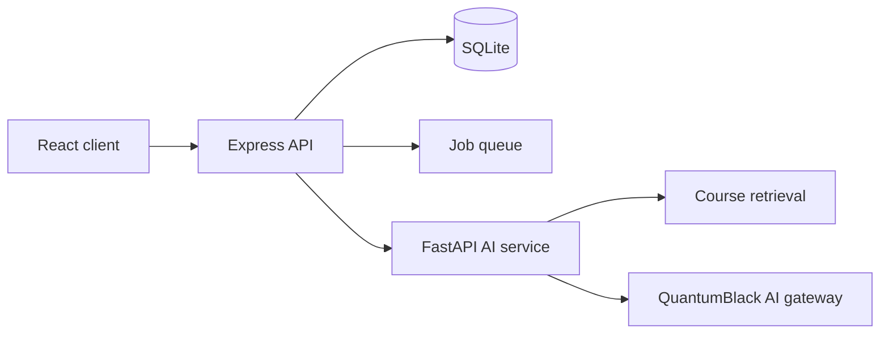

# GAP.

GAP. is a course-specific learning platform for university teachers and students. It finds the misconceptions behind students' wrong answers, groups them across a class, and helps the teacher close them with targeted explanations and follow-up checks. AI drafts quizzes, grades and explanations; the teacher approves anything a student sees.

## How it works

The product is built around one loop per class:

1. **Assess.** The teacher requests a quiz on a syllabus topic. A draft is generated with a misconception attached to each question; the teacher edits and publishes it.
2. **Grade.** Multiple-choice answers are graded against the answer key. Grades the system is not confident about are held in a review queue and stay hidden from the student until the teacher approves them.
3. **Diagnose.** Incorrect answers become per-student learning gaps, grouped into class-wide clusters and ranked by priority (students affected times severity).
4. **Explain.** For a cluster, the teacher generates an explanation and a new follow-up question, reviews it and shares it with the affected students.
5. **Verify.** Each student answers the follow-up once. A correct answer resolves their gap; a wrong one flags it for the teacher, who can share a new explanation.

Every step is recorded in an activity log, and the dashboard reflects outcomes as they happen.

## Features

**Teachers**

- Create classes and invite students with an eight-character join code
- Class overview with ranked gap clusters, student questions and students who need support
- Priority breakdown for each cluster, computed with exact Shapley values
- Quiz drafting, editing and publishing
- Review queue for uncertain grades
- Explanation drafting, editing and approval
- Activity log of generated content, approvals and student outcomes
- Voice input for text fields

**Students**

- Course list and per-course workspace: overview, practice and quizzes, materials, progress
- Study Assistant: answers grounded in the course material, with cited sources; answers that cannot be verified are withheld
- Lessons with teacher-approved explanations and a single follow-up check
- Topic progress in four states: not assessed, needs practice, completed with support, demonstrated independently
- Voice input for questions

## Architecture



- **Express** is the only service the browser can reach. It owns authentication, roles, class ownership and membership checks, request validation, persistence and background jobs.
- **The AI service** is a private FastAPI process bound to a loopback address. Each request must carry an internal token. It performs course-scoped retrieval, request routing, generation, citation checks and response review.
- **Student and course identity** passed to the AI service always comes from Express's session and database, never from the browser.
- **Rules, not the model, decide outcomes.** Gap detection, ranking and resolution are deterministic rules in Express. Model output is validated against a schema before it is stored.

See [docs/architecture.md](docs/architecture.md) for component responsibilities and runtime boundaries.

## Technology

| Area         | Stack                                                      |
| ------------ | ---------------------------------------------------------- |
| Client       | React 19, TypeScript, Vite, React Router, Web Speech API   |
| API          | Node.js 20+, Express 4, TypeScript (strict), zod, pino     |
| Storage      | SQLite via sql.js, versioned reversible migrations         |
| AI service   | Python 3.11+, FastAPI, pydantic, BM25-style retrieval      |
| Documents    | pypdf, python-docx, python-pptx                            |
| Models       | QuantumBlack AI gateway (Azure OpenAI compatible)          |
| API contract | OpenAPI 3.1, validated against responses in tests          |
| Quality      | ESLint, Prettier, Node test runner, pytest, GitHub Actions |

## Getting started

Requirements: Node.js 20.19 or later (22 or later to run the backend tests) and Python 3.11 or later.

```sh
npm ci
cp .env.example .env
npm run dev
```

Open http://localhost:3000. The client runs on port 3000 and proxies `/api` to Express on port 3001. On first start the database is migrated and seeded with a demo physics class.

Without the AI service or model credentials, Express uses a built-in local engine that covers the three demo topics. The Study Assistant requires the AI service and returns 503 without it.

### Demo accounts

| Role    | Email            | Password     |
| ------- | ---------------- | ------------ |
| Teacher | teacher@gap.demo | GapDemo!2026 |
| Student | student@gap.demo | GapDemo!2026 |
| Student | omar@gap.demo    | GapDemo!2026 |

Set `DEMO_PASSWORD` before the first start to use a different password. It is required in production.

### Enabling the AI service

1. Create the Python environment:

   ```sh
   cd apps/backend
   python3 -m venv .venv
   .venv/bin/python -m pip install -r requirements-ai.txt
   cd ../..
   ```

   On Windows, use `.venv\Scripts\python.exe`.

2. Copy `apps/backend/.env.example` to `apps/backend/.env` and add the QuantumBlack gateway credentials.
3. In the root `.env`, set `AI_SERVICE_URL=http://127.0.0.1:8001` and `AI_INTERNAL_TOKEN` to a random value of at least 32 characters.

`npm run dev` then starts the client, Express and the AI service together. Both `.env` files are ignored by Git; never commit credentials.

## Configuration

All variables are listed in [.env.example](.env.example). Express validates them at startup and exits with a list of any that are invalid. The backend variables, their defaults and the error and logging formats are documented in [apps/backend/README.md](apps/backend/README.md).

## Development

| Command                 | Purpose                                                 |
| ----------------------- | ------------------------------------------------------- |
| `npm run dev`           | Client, API and, when configured, the AI service        |
| `npm run check:backend` | Backend type check, lint, format check, tests and scans |
| `npm run test:coverage` | Backend tests with coverage thresholds, as run in CI    |
| `npm run test:student`  | Client unit tests                                       |
| `npm run typecheck`     | Type check for client and API                           |
| `npm run db -- status`  | Migration status; also `migrate`, `rollback`, `schema`  |
| `npm run build`         | Production build of client and API                      |

AI service tests:

```sh
cd apps/backend
.venv/bin/python -m pip install -r requirements-ai-dev.txt
.venv/bin/python -m pytest tests/ai
```

Git hooks installed by `npm ci` check backend changes and commit messages. CI runs the backend checks on pull requests that change backend files.

## Project layout

```
apps/
  frontend/          React client
  backend/
    src/             Express API: routes, services, repositories, migrations
    src/agents/      Assessment, content and diagnostic logic and model adapters
    app/ai/          FastAPI AI service: routing, agents, retrieval, gateway client
    openapi.yaml     HTTP API contract
    tests/ai/        AI service tests
data/schema.sql      Generated database schema, for reference
docs/                Architecture and student workspace notes
```

## Deployment

```sh
npm ci
npm run build
npm start
```

`npm start` migrates the database and serves the API and the built client from one process. Set `NODE_ENV=production`, `DEMO_PASSWORD`, and a `DATABASE_PATH` on persistent storage. Behind a load balancer, set `TRUST_PROXY`. The operations runbook is in [apps/backend/README.md](apps/backend/README.md#operations).
## Current limitations

- One API process per database file: SQLite is held in memory and written to disk on each change, and background jobs run in process. Horizontal scaling needs a shared database and an external job queue.

- The AI service keeps its retrieval index in memory and rebuilds it when course material changes.

- Teachers can import TXT, PDF, DOCX and PPTX course materials through the client. The extracted text is saved as course material, but the original uploaded documents are not persisted as separate document records.

- Scanned or image-only PDFs require OCR before import; OCR is not implemented yet.

- There is no self-service registration or password reset.

- There is no real school roster integration yet.
