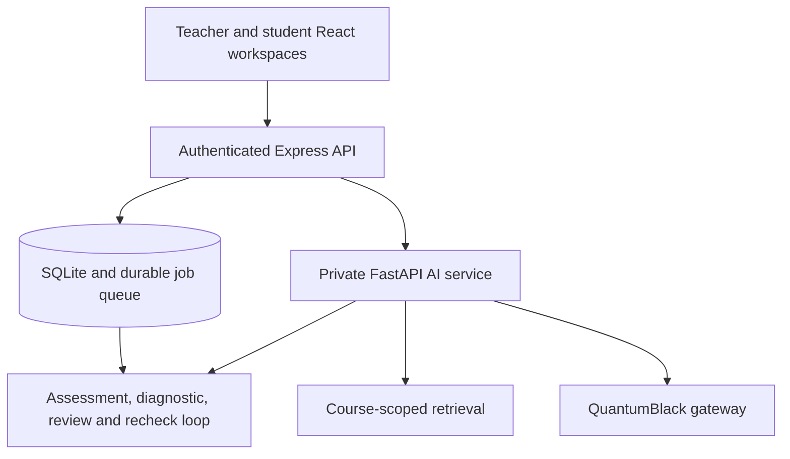

# Manara architecture

## Runtime boundaries

The browser talks only to Express. Express owns sessions, role checks, class membership, teacher ownership, request validation, persistence, durable jobs, answer-key privacy and the public OpenAPI contract. It never accepts a student id, course syllabus or material version from the browser for an AI request; those values come from the authenticated session and SQLite.

FastAPI is a private sidecar bound to a loopback address. Every request requires `X-Manara-AI-Token`. It owns the shared Python `AIService`, course-scoped retrieval, prompt construction, citation verification, deterministic response review and the QuantumBlack client. It has no public CORS surface and no student session logic.

The student Study Assistant follows this path:

1. Express authenticates the student and verifies class membership.
2. Express reads the current syllabus and `material_version` from SQLite.
3. FastAPI indexes that trusted text once per course version.
4. The orchestrator routes the prompt to the Study Agent.
5. The Study Agent retrieves only that course's chunks, generates an answer and verifies every cited source id.
6. The reviewer either publishes the grounded answer or returns a safe instructor-review notice.
7. Express stores a per-answer workflow trace and returns only the reviewed content and source metadata to the browser.

The existing TypeScript Assessment and Content agents also use the private FastAPI `/v1/model-json` adapter when it is configured. Their outputs are still validated with Zod and committed through the existing durable queue. The persistent TypeScript Diagnostic service remains the source of truth for dashboard clusters, individual gap status and recheck outcomes.

## Agent responsibilities

| Component        | Job                                                                                | Human control                                                                        |
| ---------------- | ---------------------------------------------------------------------------------- | ------------------------------------------------------------------------------------ |
| Orchestrator     | Classifies a request and sends it to Study, Assessment or Diagnostic               | Denies role-inappropriate requests and asks for clarification when intent is unclear |
| Study Agent      | Retrieves course evidence, explains a topic and returns verified citations         | Unsafe or unverifiable output is replaced by a review notice                         |
| Assessment Agent | Drafts grounded quizzes, protects answer keys, grades and emits misconception tags | Low-confidence grades remain hidden until teacher review                             |
| Diagnostic Agent | Aggregates published evidence, ranks gaps and records follow-up outcomes           | Read-only analysis; teachers act on its signals                                      |
| Reviewer         | Checks citations, publication safety and grade confidence                          | Queues uncertain work for a teacher instead of publishing it                         |

This is a routed workflow, not a Markov chain. The next action depends on authenticated role, explicit intent, course evidence, confidence and learning state. A probabilistic Markov model would add complexity without improving this deterministic, auditable hackathon loop.

## Persistence and safety

SQLite records users, sessions, classes, enrolment, quizzes, submissions, gaps, interventions, probes, questions, jobs, conversations, reviews, workflow traces and audit events. Generation jobs survive restarts and commit output with job state atomically. Low-confidence scores are withheld from student payloads. Teacher approval is required before an intervention is shared. A recheck updates only the affected student's gap and feeds the result back to the dashboard.

The instructor's Agent activity page reads course-scoped `workflow_runs` and ordered `workflow_steps`. New Study Assistant answers, quiz drafts and submissions, explanation drafts, and follow-up checks write traces in the same database transactions as their results. Teacher approvals extend the relevant trace. Steps contain component names, status, safe summaries, material version and source references where available; they do not contain prompts, private drafts, model reasoning or answer keys. Historical audit events predate this tracing feature and are not reconstructed as if their internal steps were observed. The overview also renders the existing exact-Shapley decomposition of each open topic's deterministic priority score (student count times mean gap severity). That calculation does not explain LLM reasoning.

The Python search index is still in memory. Express holds the durable instructor review queue; the Python sidecar transfers held student responses into it. A material version change causes safe re-indexing of trusted syllabus text. Teachers can also store original course files for students, but those files are not indexed for agent retrieval. A production scale-out would replace the in-memory index with a shared store and the in-process job runner with an external worker queue.
