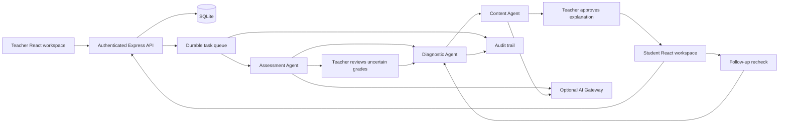

# Gap architecture

## Responsibilities

Assessment generates structured questions and rubrics; grades are validated and confidence-gated. Diagnostic clusters published misconception evidence by frequency and severity, tracks per-student outcomes, and exposes teacher signals. Content prepares syllabus-grounded explanations and follow-up questions; distribution requires teacher approval. The model adapter treats syllabus/answer content as untrusted data and validates outputs with Zod.

## Persistence and workflow

Foreign-keyed records represent users, sessions, classes, enrollment, quizzes, submissions, individual learning gaps, interventions, probes, informal questions, tasks and audit events. Schema creation is idempotent. Mutations use SQLite transactions and atomic file replacement. Generation requests are durable queued tasks; interrupted running tasks resume on startup. Generated outputs and successful task state commit together to prevent duplicate outputs after restart.

Low-confidence scores are withheld from student payloads. Approving a grade publishes the results and feeds Diagnostic. Approving an intervention shares it only with affected student gaps. Rechecks update one gap, record an attempt, and recompute class ranking; they never mark the entire class resolved.

Informal questions are persisted and shown to the teacher. The current engine does not infer new misconception labels from free-form questions automatically.

## Runtime boundaries

React communicates only through authenticated JSON APIs. Credentials and answer keys stay on the backend. Teacher routes verify ownership; student routes verify enrollment and individual gap ownership. Teacher/student navigation is separate; authorization is enforced on the server, not only by hiding UI controls.

The local engine provides deterministic physics examples and conservative rubric signals. Live AI generation/grading requires a gateway API key and a configured model. The live adapter is implemented but cannot be verified without credentials. The single-process SQLite export store is appropriate for this local hackathon build; horizontal scaling requires a shared database and queue.

See the workflow integration test for review gating, role isolation, answer-key redaction, approved content distribution, incorrect escalation, individual resolution, persisted results and session invalidation.
