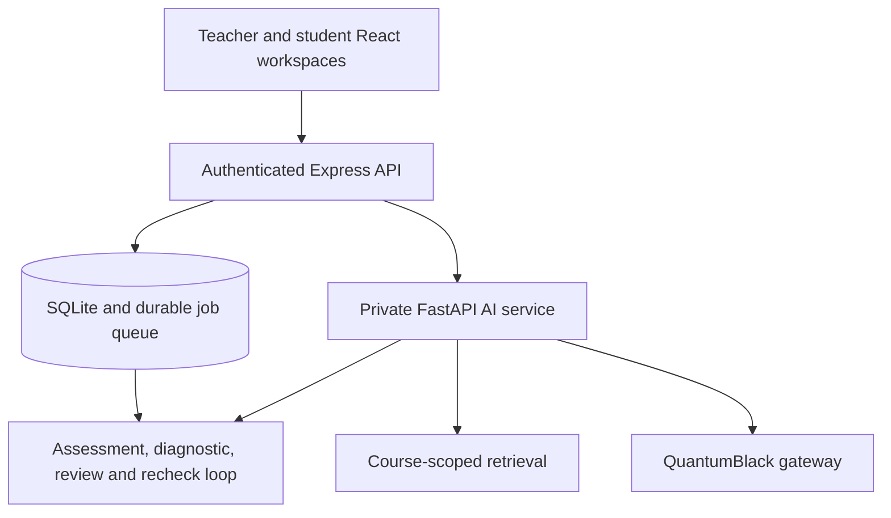

# Manara architecture

## Runtime boundaries

The browser talks only to Express. Express owns sessions, role checks, class membership, teacher ownership, request validation, persistence, durable jobs, answer-key privacy and the public OpenAPI contract. It never accepts a student id, course syllabus or material version from the browser for an AI request; those values come from the authenticated session and SQLite.

FastAPI is a private sidecar bound to a loopback address. Every request requires `X-Manara-AI-Token`. It owns the shared Python `AIService`, course-scoped retrieval, prompt construction, citation verification, deterministic response review and the QuantumBlack client. It has no public CORS surface and no student session logic.

The student Study Assistant follows this path:

1. Express authenticates the student and verifies class membership.
2. Express reads the current syllabus and `material_version` from SQLite.
3. FastAPI indexes that trusted text once per course version.
4. The orchestrator routes the prompt to the Study Agent.
5. The Study Agent retrieves only that course's chunks, generates an answer and verifies every cited source id.
6. The reviewer either publishes the grounded answer or returns a safe instructor-review notice.
7. Express returns only the reviewed content and source metadata to the browser.

The existing TypeScript Assessment and Content agents also use the private FastAPI `/v1/model-json` adapter when it is configured. Their outputs are still validated with Zod and committed through the existing durable queue. The persistent TypeScript Diagnostic service remains the source of truth for dashboard clusters, individual gap status and recheck outcomes.

## Agent responsibilities

| Component        | Job                                                                                | Human control                                                                        |
| ---------------- | ---------------------------------------------------------------------------------- | ------------------------------------------------------------------------------------ |
| Orchestrator     | Classifies a request and sends it to Study, Assessment or Diagnostic               | Denies role-inappropriate requests and asks for clarification when intent is unclear |
| Study Agent      | Retrieves course evidence, explains a topic and returns verified citations         | Unsafe or unverifiable output is replaced by a review notice                         |
| Assessment Agent | Drafts grounded quizzes, protects answer keys, grades and emits misconception tags | Low-confidence grades remain hidden until teacher review                             |
| Diagnostic Agent | Aggregates published evidence, ranks gaps and records follow-up outcomes           | Read-only analysis; teachers act on its signals                                      |
| Reviewer         | Checks citations, publication safety and grade confidence                          | Queues uncertain work for a teacher instead of publishing it                         |

This is a routed workflow, not a Markov chain. The next action depends on authenticated role, explicit intent, course evidence, confidence and learning state. A probabilistic Markov model would add complexity without improving this deterministic, auditable hackathon loop.

## Persistence and safety

SQLite records users, sessions, classes, enrolment, quizzes, submissions, gaps, interventions, probes, questions, jobs and audit events. Generation jobs survive restarts and commit output with job state atomically. Low-confidence scores are withheld from student payloads. Teacher approval is required before an intervention is shared. A recheck updates only the affected student's gap and feeds the result back to the dashboard.

The Python search index and its review queue are in memory in this P0 build. Express remains the durable source of truth, and a material version change causes safe re-indexing. A production scale-out would replace the in-memory index with a shared vector store and the in-process queue with an external worker queue.

The Python ingestion layer can parse PDF, Word (`.docx`) and PowerPoint (`.pptx`) files. The current browser-to-Express integration indexes the trusted syllabus text already stored for a class; uploading and persisting source files through the teacher UI remains P2 work. Until that path is implemented, do not describe document upload as an end-to-end feature.
